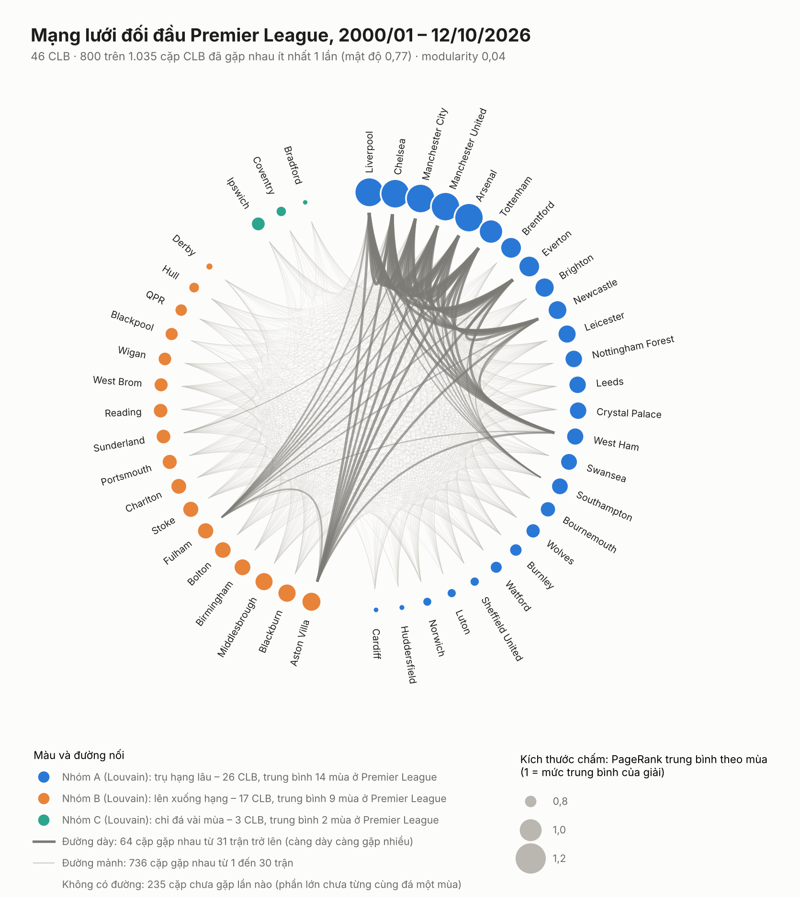
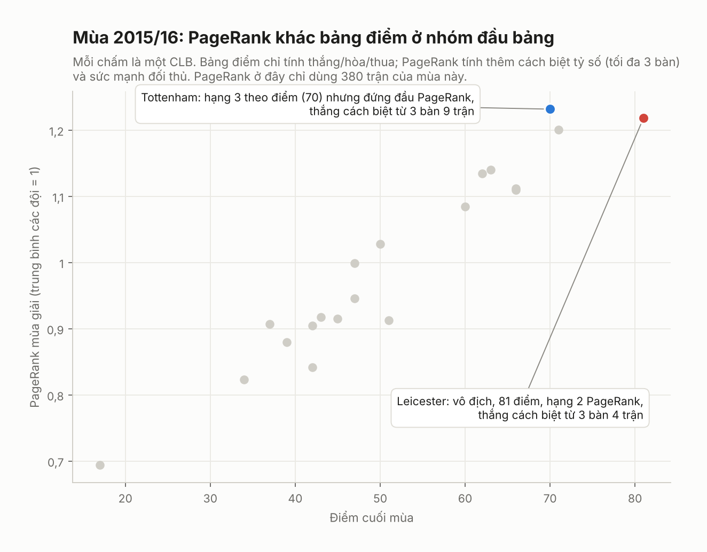
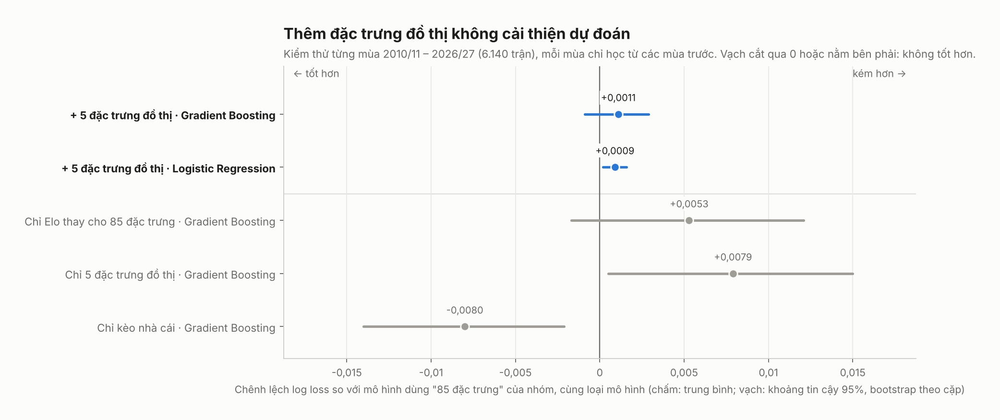

# Cách đọc các hình

Năm hình nằm trong `link_analysis/figures/` (bản sao trong `hinh/` của hồ sơ này). Mọi hình được vẽ bằng một module duy nhất `src/figures.py`, dùng chung cho script và notebook, nên kiểu dáng và quy ước màu thống nhất:

| Màu | Ý nghĩa |
|---|---|
| Xanh dương | Dữ liệu chính, hoặc nhóm cần chú ý theo nghĩa tích cực (6 CLB mạnh nhất, cấu hình có đồ thị) |
| Đỏ | Điểm cần chú ý đặc biệt (mùa lệch nhất, đội vô địch trong ví dụ, cặp chênh lệch nhất) |
| Xám | Bối cảnh, làm nền |
| Cam, xanh lá | Nhóm B và nhóm C của Louvain, chỉ dùng ở hình mạng lưới bản thường |

Số liệu trên hình dùng dấu phẩy thập phân. Vẽ lại toàn bộ hình 1–3: `python src/network_analysis.py --matches matches.csv --out results --figures figures` (khoảng 10 giây). Hình 4 được sinh cuối `src/evaluate.py`.

---

## Hình 1. Mạng lưới đối đầu, bản thường (`1_mang_luoi.png`)

**Mục đích.** Cho toàn cảnh mạng lưới: có bao nhiêu CLB, các nhóm Louvain là gì, ai mạnh.

**Cách đọc.**
- Mỗi chấm là một CLB, xếp trên vòng tròn theo nhóm rồi theo sức mạnh giảm dần (theo chiều kim đồng hồ từ đỉnh).
- Kích thước chấm là PageRank trung bình của CLB qua các mùa đã kết thúc mà CLB có đá (1 = mức trung bình của giải). Chú giải bên phải có ba mốc 0,8 / 1,0 / 1,2.
- **Mọi cặp đã gặp đều được vẽ:** 736 cặp gặp nhau từ 1 đến 30 trận là đường mảnh, 64 cặp gặp từ 31 trận trở lên là đường dày (càng dày càng gặp nhiều). Vì vậy **không có đường đúng nghĩa là chưa gặp lần nào** (235 cặp, tính đến 12/10/2026).
- 235 cặp chưa gặp gồm 226 cặp chưa từng cùng đá một mùa Premier League, và 9 cặp cùng ở mùa 2026/27 nhưng chưa đến lượt gặp (dữ liệu dừng ở 12/10/2026, mùa mới đá 60 trận).
- Bố cục vòng tròn được chọn vì mạng gần như đầy đủ: bố cục lực đẩy (spring layout) sẽ dồn mọi nút thành một cụm.

**Điểm chính.**
- Phụ đề nêu các con số cấu trúc: 800 trên 1.035 cặp đã gặp (mật độ 0,77), modularity 0,04.
- Ba nhóm Louvain được đặt tên theo đặc điểm thật (số mùa trung bình ở Premier League): trụ hạng lâu (26 CLB, 14 mùa), lên xuống hạng (17 CLB, 9 mùa), chỉ đá vài mùa (3 CLB, 2 mùa). Tên nhóm là mô tả sau khi phân nhóm, không phải tiêu chí phân nhóm.
- Đường dày tập trung giữa các CLB đá gần như mọi mùa; vùng đường mảnh dày đặc ở giữa cho thấy mật độ cao.

**Câu hỏi có thể gặp.** "Hai đội không có đường nối là chưa gặp?" Đúng: mọi cặp đã gặp đều có ít nhất một đường mảnh. "Sao có đường mảnh, đường dày?" Để vừa thể hiện đủ 800 cặp (mật độ), vừa làm nổi các cặp gặp nhiều nhất mà không thành một khối rối.

---

## Hình 1b. Mạng lưới đối đầu, bản nổi bật (`1b_mang_luoi_noi_bat.png`)

**Mục đích.** Cùng mạng lưới và cùng cách vẽ đường (mọi cặp đã gặp đều có đường), nhưng chỉ tô màu ba điểm đáng chú ý; phần còn lại làm mờ.

**Điểm chính (đều ghi ngay trên hình).**
1. **6 CLB mạnh nhất** (PageRank trung bình cao nhất: Liverpool, Chelsea, Manchester City, Manchester United, Arsenal, Tottenham): mỗi cặp gặp nhau khoảng 51 trận, tạo thành các cạnh dày nhất.
2. **Nhóm C** (Bradford, Coventry, Ipswich): không phải "cụm đối thủ". Đây là 3 CLB có ít mùa nhất ở Premier League (Bradford 1, Coventry 2, Ipswich 4), cùng đá mùa 2000/01; Coventry và Ipswich trở lại ở các mùa gần đây (Ipswich 2024/25, cả hai ở 2026/27). Louvain gom chúng lại chỉ vì chúng gặp rất ít đội. Đây là minh chứng trực quan cho modularity thấp.
3. **Cặp chênh lệch nhất** trong các cặp gặp ít nhất 20 lần: Burnley – Manchester City, 20 trận, Burnley thắng 1, hòa 3, thua 16, tức giành 6 trên 57 điểm mà hai đội có được trong các trận này (11%).
4. Hộp kết luận: mạng gần đầy đủ và gần như không có cụm, nên vị trí trong mạng ít phân biệt các đội; thông tin chính nằm ở sức mạnh (PageRank), vốn trùng với Elo. Đây là cầu nối sang kết quả đánh giá.

**Dùng khi nào.** Slide trình bày và báo cáo: dùng bản này. Bản thường dùng làm phụ lục hoặc khi cần tra cứu một CLB cụ thể.

---

## Hình 2. PageRank so với bảng xếp hạng theo mùa (`2_pagerank_vs_bxh.png`)

**Mục đích.** Kiểm tra PageRank có phải thước đo sức mạnh hợp lý không, trước khi dùng làm đặc trưng.

**Cách đọc.** Mỗi chấm là một mùa đủ 380 trận (bỏ 2003/04, 2004/05 vì dữ liệu chỉ có 335 trận, dải xám trên hình; bỏ 2026/27 đang đá). Trục hoành theo năm thật nên mùa bị bỏ hiện thành khoảng trống. Trục tung là tương quan hạng Spearman giữa PageRank mùa đó và bảng xếp hạng cuối mùa; 1 là khớp hoàn toàn. Đường đứt là trung bình.

**Điểm chính.**
- Trung bình 0,937: PageRank xếp các đội gần giống bảng điểm.
- Chấm đỏ 2002/03 (0,806) là mùa lệch nhất: Leeds hạng 15 theo điểm nhưng hạng 8 theo PageRank; Aston Villa hạng 16 nhưng hạng 9. Leeds (hạng 15) giành 12 điểm và Aston Villa (hạng 16) giành 11 điểm trước 6 đội đầu bảng, nhiều hơn các đội cùng nhóm điểm như Fulham (9) và Charlton (6), nhưng mất nhiều điểm trước các đội còn lại. PageRank coi trọng kết quả trước đội mạnh nên xếp hai đội này cao hơn bảng điểm.
- Đội vô địch xếp hạng 1 theo PageRank ở 19/24 mùa và luôn trong top 3.

**Câu hỏi có thể gặp.** "Tương quan cao có chứng minh PageRank tốt không?" Không hẳn: cả hai tính từ cùng kết quả, nên đây là kiểm tra tính hợp lý. Giá trị nằm ở chỗ lệch giải thích được.

---

## Hình 3. Ví dụ mùa 2015/16 (`3_vi_du_mua_2015_16.png`)

**Mục đích.** Minh họa trực quan PageRank khác bảng điểm ở chỗ nào.

**Cách đọc.** Mỗi chấm là một CLB; trục hoành là điểm cuối mùa, trục tung là PageRank tính chỉ từ 380 trận của mùa này (khác với đặc trưng `gr_pagerank_*` dùng cửa sổ 3 năm). Các CLB gần như nằm trên một đường tăng: hai thước đo gần cùng thứ tự.

**Điểm chính.** Leicester vô địch với 81 điểm nhưng chỉ hạng 2 PageRank. Tottenham đứng đầu PageRank (1,232 so với 1,218 của Leicester) dù kém 11 điểm. Lý do: bảng điểm chỉ tính thắng/hòa/thua, còn PageRank tính thêm cách biệt tỷ số (tối đa 3 bàn) và sức mạnh đối thủ. Tottenham thắng cách biệt từ 3 bàn 9 trận (Leicester 4), và phần điểm trung bình trước 8 đội đầu bảng cao hơn (0,60 so với 0,52). Cần nói rõ: xét điểm số thuần, Leicester vẫn giành nhiều điểm hơn trước 8 đội đầu bảng (21 so với 20); khác biệt nằm ở cách biệt tỷ số.

---

## Hình 4. Kết quả đánh giá (`4_danh_gia.png`)

**Mục đích.** Trả lời câu hỏi chính: thêm đặc trưng đồ thị có làm dự đoán tốt hơn không.

**Cách đọc.**
- Mỗi dòng là một cấu hình, so với tham chiếu "85 đặc trưng" của nhóm. Chấm là chênh lệch log loss trung bình, vạch là khoảng tin cậy 95% (bootstrap theo cặp).
- Bên trái số 0 là tốt hơn, bên phải là kém hơn. Vạch cắt qua 0 nghĩa là không phân biệt được.
- Hai dòng xanh, chữ đậm phía trên là câu hỏi chính (thêm 5 đặc trưng đồ thị, với hai mô hình). Ba dòng xám phía dưới là mốc so sánh.

**Điểm chính.**
- Gradient Boosting: +0,0011, khoảng [−0,0009; +0,0029] chứa 0: không cải thiện.
- Logistic Regression: +0,0009, khoảng [+0,0002; +0,0016] nằm hẳn bên phải: hơi kém đi.
- Chỉ 5 đặc trưng đồ thị gần với chỉ Elo: đồ thị nắm được sức mạnh đội nhưng không thêm gì mới.
- Chỉ kèo nhà cái là tốt nhất (nằm hẳn bên trái), cho thấy thang đo nhạy đủ để phát hiện tín hiệu thật khi có.

**Câu hỏi có thể gặp.** "Chênh lệch 0,001 có đáng kể không?" Khoảng cách giữa Elo và kèo nhà cái chỉ khoảng 0,01, nên 0,001 không phải nhỏ tuyệt đối; nhưng khoảng tin cậy chứa 0, nên không thể khẳng định có khác biệt.
